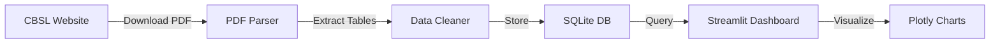

# 🇱🇰 Sri Lanka Daily Price Report — Dashboard Analysis & Plan

## 🎯 Business Context
You're an **Indian export company** tracking daily market prices in Sri Lanka (importing country) to make better pricing, timing, and supply decisions. The Central Bank of Sri Lanka (CBSL) publishes daily PDFs with wholesale & retail prices across key markets.

---

## 📊 Data Source Deep Dive

### PDF URL Pattern (Predictable ✅)
```
https://www.cbsl.gov.lk/sites/default/files/cbslweb_documents/statistics/pricerpt/price_report_{YYYYMMDD}_e.pdf
```
**Example:** `price_report_20261030_e.pdf` → Oct 30, 2026

### What's Inside Each PDF (2 Pages)

**Page 1 — Summary with Charts:**
| Category | Items Covered | Markets |
|----------|--------------|---------|
| Vegetables | Beans, Brinjal, Lime, etc. | Pettah, Dambulla |
| Fish | Salaya, Linna, etc. | Peliyagoda, Negombo |
| Others | Big Onion (Imported), Coconut | Dambulla |

Each item includes: **Yesterday price, Today price, price direction (↑↓), and a 30-day chart**

**Page 2 — Detailed Price Table (THE GOLD MINE 💎):**

| Structure | Details |
|-----------|---------|
| Markets | **Pettah**, **Dambulla**, **Narahenpita** |
| Price Types | **Wholesale** (Pettah, Dambulla) + **Retail** (Pettah, Dambulla, Narahenpita) |
| Each cell | `Yesterday` + `Today` prices |
| Categories | **VEGETABLES** (9+ items), **OTHER** (8+ items), **FRUITS** (3+ items), **FISH** (10+ items), **RICE** (6+ items), **ESSENTIALS** (6+ items) |

### Key Items Tracked (from PDF)
```
VEGETABLES:     Beans, Carrot, Leeks, Capsicum, Brinjal, Ladies Fingers, Tomato, 
                Beetroot, Lime
OTHER:          Red Onion (Local/Import), Big Onion (Import), Potatoes (Local/Import),
                Green Chillies, Eggs, Coconut, White Sugar, Wheat Flour, Milk Powder,
                Dhal, LP Gas
FRUITS:         Banana (Ambul/Kolikuttu), Papaw, Watermelon
FISH:           Kelawalla, Balaya, Salaya, Hurulla, Seer, Thalapath, Linna, 
                Prawns, Cuttlefish
RICE:           Nadu, Samba, Keeri Samba, Red Raw, White Raw, Red Kekulu
```

---

## 🏗️ Proposed Architecture

### Tech Stack
| Component | Technology | Why |
|-----------|-----------|-----|
| **Dashboard** | Streamlit | Fast prototyping, Python native, easy hosting on Streamlit Cloud |
| **PDF Scraping** | `pdfplumber` + `requests` | Reliable table extraction from PDFs |
| **Data Storage** | SQLite (local) + CSV backup | Lightweight, no server needed, portable |
| **Charts** | Plotly | Interactive, stock-market-style candlestick/line charts |
| **Scheduling** | Built-in auto-refresh + manual trigger | Fetch latest PDF on each dashboard load |

### Data Pipeline


---

## 📈 Dashboard Features

### 1. **Live Today's Prices** (Hero Section)
- Big cards showing today's prices for key items you export
- 🟢🔴 indicators for price up/down vs yesterday
- Last updated timestamp

### 2. **Stock-Market Style Charts**
- **Line charts** with 30/60/90/180 day trends per item
- **Candlestick charts** showing daily open/close (wholesale vs retail)
- **Area charts** for price ranges across markets
- Volume-style indicators for price volatility

### 3. **Multi-Item Comparison**
- Compare prices of 2-5 items on the same chart
- Compare same item across Pettah vs Dambulla vs Narahenpita
- Wholesale vs Retail spread analysis

### 4. **Smart Filters**
- By **Category**: Vegetables, Fish, Rice, Fruits, Others
- By **Item**: Individual item search/select
- By **Market**: Pettah, Dambulla, Narahenpita
- By **Date Range**: Custom date picker
- By **Price Type**: Wholesale / Retail

### 5. **Export Intelligence**
- Price alerts when items cross threshold
- Best day/week to buy analysis
- Seasonal trend analysis
- Wholesale-Retail margin tracker

### 6. **Data Management**
- One-click "Fetch Latest" button
- Bulk historical data download
- Export to Excel/CSV

---

## ⚠️ Challenges & Solutions

| Challenge | Solution |
|-----------|----------|
| PDF table extraction is messy (spaces in numbers like "5 00.00") | Custom regex parser to clean prices |
| PDFs not published on weekends/holidays | Skip missing dates gracefully |
| Item names may vary slightly | Fuzzy matching + manual mapping dictionary |
| Historical data (205+ pages of PDFs) | Batch scraper to build initial database |
| No API available | Predictable URL pattern makes scraping reliable |

---

## 🚀 Development Phases

### Phase 1: Core (Building Now)
- [x] PDF URL pattern discovered
- [x] PDF structure analyzed
- [ ] Build PDF parser with clean data extraction
- [ ] SQLite database schema
- [ ] Streamlit dashboard with basic charts
- [ ] Item-level filters

### Phase 2: Intelligence
- [ ] Multi-item comparison
- [ ] Seasonal trend analysis
- [ ] Price alert system
- [ ] Wholesale vs Retail margin tracker

### Phase 3: Production
- [ ] Auto-scheduler (daily cron)
- [ ] Streamlit Cloud deployment
- [ ] Telegram/WhatsApp notifications
- [ ] Multi-language support (Sinhala items)
